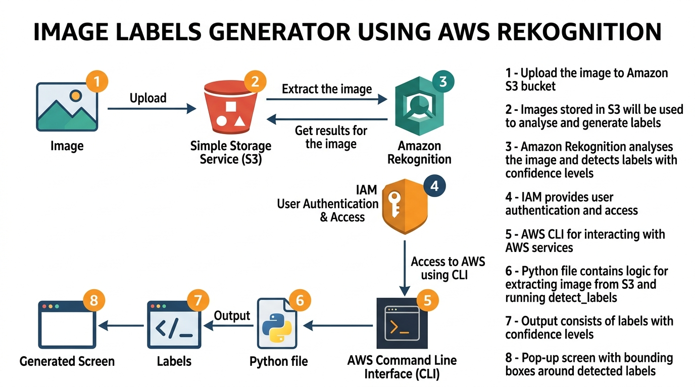

# 🏷️ Image Labels Generator Using Amazon Rekognition

An automated image labeling tool that leverages **Amazon Rekognition** to detect and classify objects in images stored in **Amazon S3**. The tool generates bounding boxes around detected objects and displays them using **Matplotlib**.

---

## 📐 Architecture Diagram



### How It Works

| Step | Description |
|------|-------------|
| **1** | Upload the image to Amazon S3 bucket. |
| **2** | The images stored in the S3 bucket will be used to analyse and generate labels. |
| **3** | Amazon Rekognition will be used to analyse the selected image from the S3 bucket and detecting labels with their confidence levels. |
| **4** | IAM will be used to provide user authentication and access to the Amazon CLI on your system. |
| **5** | AWS Command Line Interface will be used for interacting with AWS services. |
| **6** | Python file will consist of the programming logic for extracting the image from S3 and running `detect_labels` operation from Rekognition. |
| **7** | The output will consist of number of specified labels according to the input with their confidence levels. |
| **8** | A pop-up screen will be generated with the image chosen from S3 bucket with bounding boxes around the detected labels. |

---

## 🛠️ Tech Stack

- **Python 3.x**
- **AWS SDK (Boto3)** — For interacting with S3 and Rekognition
- **Amazon Rekognition** — AI-powered image analysis
- **Amazon S3** — Cloud storage for images
- **AWS IAM** — Identity and access management
- **Matplotlib** — Visualization and bounding box rendering
- **Pillow (PIL)** — Image processing

---

## 📋 Prerequisites

Before running this project, ensure you have:

1. **Python 3.7+** installed
2. **AWS Account** with the following services enabled:
   - Amazon S3
   - Amazon Rekognition
3. **AWS CLI** installed and configured
4. **IAM User** with the following permissions:
   - `AmazonRekognitionReadOnlyAccess`
   - `AmazonS3ReadOnlyAccess`

---

## ⚙️ Setup & Installation

### 1. Clone the Repository

```bash
git clone https://github.com/Krish-Bavariya/image-labels-generator-using-Amazon-Rekognition.git
cd image-labels-generator-using-Amazon-Rekognition
```

### 2. Install Dependencies

```bash
pip install -r requirements.txt
```

### 3. Configure AWS CLI

```bash
aws configure
```

Enter your:
- **AWS Access Key ID**
- **AWS Secret Access Key**
- **Default region** (e.g., `us-east-1`)
- **Output format** (e.g., `json`)

### 4. Upload an Image to S3

```bash
aws s3 cp your-image.png s3://your-bucket-name/
```

### 5. Update Configuration

Open `image_labeler.py` and update the following variables in the `main()` function:

```python
photo = 'your-image-filename.png'   # Name of image in S3
bucket = 'your-bucket-name'          # Your S3 bucket name
region = 'us-east-1'                 # Your AWS region
```

---

## 🚀 Usage

Run the script:

```bash
python image_labeler.py
```

### Output

The script will:
1. **Print detected labels** with their confidence scores to the console
2. **Display the image** with red bounding boxes around detected objects
3. **Show label names** and confidence percentages above each bounding box

### Example Console Output

```
Detected labels for your-image.png

Label: Person
Confidence: 99.87

Label: Dog
Confidence: 98.54

Label: Cat
Confidence: 97.23

Labels detected: 15
```

---

## 📁 Project Structure

```
image-labels-generator-using-Amazon-Rekognition/
│
├── image_labeler.py      # Main Python script
├── requirements.txt      # Python dependencies
├── architecture.png      # Architecture diagram
├── .gitignore            # Git ignore rules
└── README.md             # Project documentation
```

---

## 🔑 IAM Policy Setup

Your IAM user needs the following permissions. Attach these policies in the **AWS IAM Console**:

<details>
<summary>📄 Custom Inline Policy (Minimum Privilege)</summary>

```json
{
  "Version": "2012-10-17",
  "Statement": [
    {
      "Effect": "Allow",
      "Action": [
        "rekognition:DetectLabels"
      ],
      "Resource": "*"
    },
    {
      "Effect": "Allow",
      "Action": [
        "s3:GetObject"
      ],
      "Resource": "arn:aws:s3:::your-bucket-name/*"
    }
  ]
}
```

</details>

Or attach these **AWS Managed Policies**:
- `AmazonRekognitionReadOnlyAccess`
- `AmazonS3ReadOnlyAccess`

---

## 🤝 Contributing

Contributions are welcome! Feel free to open an issue or submit a pull request.

---

## 📄 License

This project is open source and available under the [MIT License](LICENSE).

---

## 👤 Author

**Krish Bavariya**

- GitHub: [@Krish-Bavariya](https://github.com/Krish-Bavariya)
